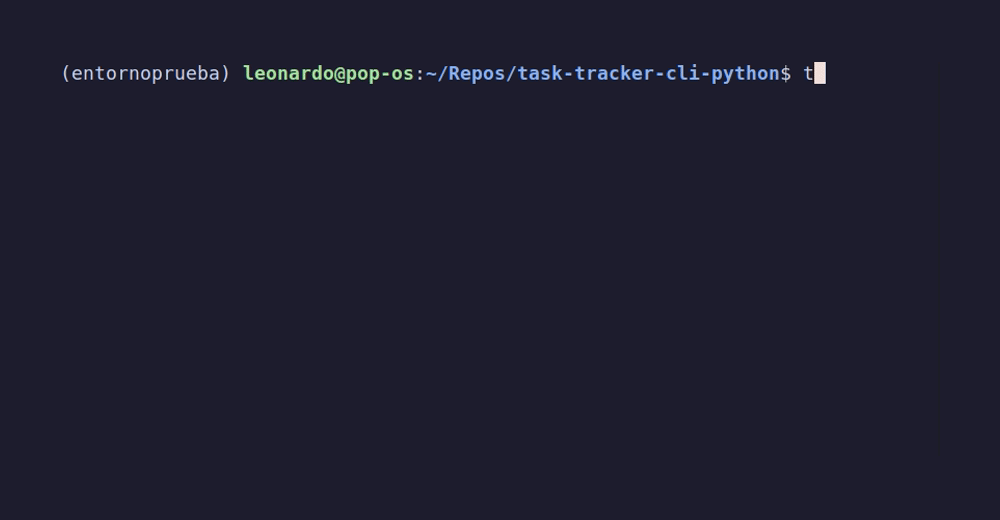
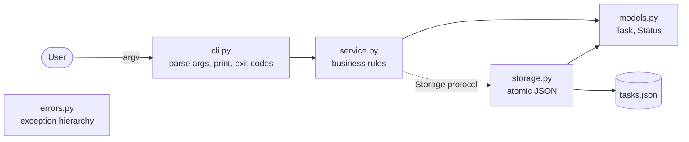

<div align="center">

# Task Tracker CLI

**Manage your tasks from the terminal.**

A Python CLI with atomic JSON persistence, a layered architecture, and zero external dependencies.

[](https://github.com/patoruzito/task-tracker-cli-python/actions/workflows/ci.yml)


</div>

Built from the [roadmap.sh Task Tracker project](https://roadmap.sh/projects/task-tracker) as a portfolio piece: a small tool written with production habits.

- **Never loses data.** Atomic writes, and a file it cannot read is reported, never overwritten.
- **Layered.** Domain, service, storage and CLI are decoupled through dependency injection.
- **Tested.** Unit, integration and end-to-end tests, run on Python 3.10–3.13 in CI.
- **Strictly typed and linted.** `mypy --strict` and `ruff` on every push.
- **Zero runtime dependencies.** Standard library only.

<div align="center">
  
</div>

## Quick start

```bash
task-cli add "Buy groceries"      # Task added successfully (ID: 1)
task-cli mark-in-progress 1       # Task 1 marked as in-progress
task-cli list in-progress         # 1    in-progress   Buy groceries
task-cli mark-done 1              # Task 1 marked as done
```

## Table of contents

- [Installation](#installation)
- [1. Data model](#1-data-model)
- [2. File format](#2-file-format)
- [3. Commands](#3-commands)
- [4. Output and exit codes](#4-output-and-exit-codes)
- [5. Errors](#5-errors)
- [6. Architecture](#6-architecture)
- [7. Design decisions](#7-design-decisions)
- [8. Development](#8-development)
- [9. Out of scope](#9-out-of-scope)
- [License](#license)

---

## Installation

Requires **Python 3.10 or later**.

```bash
git clone https://github.com/patoruzito/task-tracker-cli-python.git
cd task-tracker-cli-python
python3 -m venv .venv
source .venv/bin/activate        # Windows: .venv\Scripts\activate
pip install -e .
task-cli --help
```

Without installing, from the project root: `PYTHONPATH=src python -m task_tracker --help`.

> [!TIP]
> The contract below (sections 1–5) is the specification: it is what the program promises, and the tests check every line of it. Any change in behavior starts by updating it.

---

## 1. Data model

### 1.1 Task properties

Every task has exactly these five properties:

| Property      | JSON type | Description | Rules |
|---------------|-----------|-------------|-------|
| `id`          | integer   | Unique identifier of the task | Integer ≥ 1, assigned by the system. **Never reused**, even after the task is deleted. Immutable. |
| `description` | string    | Short description of the task | Stored with leading and trailing whitespace removed. Cannot be empty. Maximum 200 characters. Unicode allowed. |
| `status`      | string    | Status of the task | One of: `todo`, `in-progress`, `done`. Always `todo` on creation. |
| `createdAt`   | string    | Date and time the task was created | ISO 8601 in UTC with offset (`2026-11-22T15:24:00+00:00`), second precision. Set on creation and **never changes**. |
| `updatedAt`   | string    | Date and time of the last change | Same format as `createdAt`. Equal to `createdAt` on creation. |

### 1.2 When each property changes

| Operation | `id` | `description` | `status` | `createdAt` | `updatedAt` |
|-----------|------|---------------|----------|-------------|-------------|
| `add`              | assigned | assigned | `todo` | now | = `createdAt` |
| `update`           | — | new value | — | — | now |
| `mark-in-progress` | — | — | `in-progress` | — | now |
| `mark-done`        | — | — | `done` | — | now |
| `delete`           | the task is removed; its `id` is never used again | | | | |

> [!IMPORTANT]
> **No-op rule:** if `update` receives the description the task already has, or a `mark-*` command requests the status it is already in, the operation succeeds but **changes nothing**, including `updatedAt`. `updatedAt` records real changes, not attempts.

### 1.3 Status transitions

Any status can move to any other through `mark-in-progress` or `mark-done`. There is no command to go back to `todo`; that is out of scope (see section 6).

---

## 2. File format

Tasks are stored in `tasks.json` in the **current directory**. A different path can be set with the `TASK_CLI_FILE` environment variable.

```json
{
  "version": 1,
  "next_id": 3,
  "tasks": [
    {
      "id": 1,
      "description": "Buy groceries",
      "status": "done",
      "createdAt": "2026-11-22T15:24:00+00:00",
      "updatedAt": "2026-11-22T18:02:11+00:00"
    },
    {
      "id": 2,
      "description": "Write README",
      "status": "in-progress",
      "createdAt": "2026-11-22T15:30:45+00:00",
      "updatedAt": "2026-11-22T16:10:03+00:00"
    }
  ]
}
```

| Field     | Purpose |
|-----------|---------|
| `version` | Schema version. Allows migrating old files if the format changes. |
| `next_id` | Next ID to assign. Guarantees a deleted ID is never reused. |
| `tasks`   | List of tasks, sorted by ascending `id`. |

### Storage guarantees

| Guarantee | Behavior |
|-----------|----------|
| **Automatic creation** | If the file does not exist, it is created by the first operation that writes (`add`). Read commands treat a missing file as an empty list and do not create it. |
| **Atomic writes** | Data is written to a temporary file that replaces the original in a single step. If the process is interrupted, the file is left in either its previous or its new version, never half-written. |
| **Corrupt file** | If the JSON cannot be parsed or does not match the schema, the program exits with an error and **does not overwrite it**. |
| **Unknown version** | A file with a `version` higher than the supported one is rejected with an error and left untouched. |
| **Older format** | A bare list of tasks (the format without `version` or `next_id`) is migrated in memory and written in the current format on the next save. |
| **Encoding** | UTF-8, indented with 2 spaces. |

> [!CAUTION]
> The program never overwrites a file it cannot read. Losing a user's data is treated as the worst possible failure.

---

## 3. Commands

General form:

```
task-cli <command> [arguments]
```

Arguments are positional. A description containing spaces must be quoted.

### `add <description>`

Creates a task with status `todo`.

```bash
$ task-cli add "Buy groceries"
Task added successfully (ID: 1)
```

### `update <id> <description>`

Changes a task's description.

```bash
$ task-cli update 1 "Buy groceries and cook dinner"
Task 1 updated successfully
```

If the new description is the same as the current one (after trimming spaces), nothing changes:

```bash
$ task-cli update 1 "Buy groceries and cook dinner"
Task 1 already has that description
```

### `delete <id>`

Deletes a task.

```bash
$ task-cli delete 1
Task 1 deleted successfully
```

### `mark-in-progress <id>` / `mark-done <id>`

Changes a task's status.

```bash
$ task-cli mark-in-progress 1
Task 1 marked as in-progress

$ task-cli mark-done 1
Task 1 marked as done
```

If the task already had that status:

```bash
$ task-cli mark-done 1
Task 1 is already done
```

### `list [status]`

Lists tasks sorted by `id`. With no argument it shows all of them; with an argument it filters by status.

| Command | Shows |
|---------|-------|
| `task-cli list`             | All tasks |
| `task-cli list todo`        | Tasks in `todo` |
| `task-cli list in-progress` | Tasks in `in-progress` |
| `task-cli list done`        | Tasks in `done` |

```bash
$ task-cli list
ID   STATUS        DESCRIPTION
1    done          Buy groceries
2    in-progress   Write README
3    todo          Study argparse
```

With no results:

```bash
$ task-cli list done
No tasks found
```

### `--help` / `--version`

`task-cli --help` and `task-cli <command> --help` show usage help. `task-cli --version` prints the installed version.

---

## 4. Output and exit codes

- **Results** are written to **stdout**.
- **Errors** are written to **stderr** with the prefix `error: `.
- No error ever shows a Python traceback.

| Exit code | Meaning | Examples |
|-----------|---------|----------|
| `0` | Success, including no-ops | Task added, empty list, `mark-done` on a task already `done` |
| `1` | Runtime error | Task not found, invalid description, corrupt file |
| `2` | Incorrect usage | Unknown command, missing arguments, `id` that is not a positive integer, invalid `list` filter |
| `130` | Interrupted | Ctrl+C while the command was running |

---

## 5. Errors

| Situation | Message (stderr) | Exit |
|-----------|------------------|------|
| ID does not exist | `error: task 99 not found` | 1 |
| Empty or whitespace-only description | `error: description cannot be empty` | 1 |
| Description longer than 200 characters | `error: description exceeds 200 characters` | 1 |
| Corrupt file | `error: cannot read tasks.json (invalid JSON); file left untouched` | 1 |
| Unsupported file version | `error: tasks.json uses schema version 2; this program supports up to 1` | 1 |
| No write permission | `error: cannot write tasks.json: Permission denied` | 1 |
| Unknown command, missing arguments, invalid `id` or invalid filter | `argparse` usage message | 2 |

---

## 6. Architecture

Dependencies point inward: the CLI knows the service, the service knows the model, and the model knows nothing else. The storage is injected into the service through a `Protocol`, so the service never imports it.



| Module | Responsibility | Knows about |
|--------|----------------|-------------|
| `models.py` | `Task` and `Status`, conversion to and from dicts | Nothing in the project except `errors` |
| `service.py` | Every rule: IDs, validation, the no-op rule, `updatedAt` | Models and the `Storage` protocol |
| `storage.py` | Reading, migrating, validating and atomically writing the file | Models |
| `cli.py` | Arguments, output formatting, exceptions to exit codes | Everything; it wires the pieces together |
| `errors.py` | One exception hierarchy under `TaskTrackerError` | Nothing |

### Project structure

```
task-tracker-cli-python/
├── pyproject.toml          # metadata, entry point, tool configuration
├── src/task_tracker/
│   ├── __init__.py
│   ├── __main__.py         # python -m task_tracker
│   ├── cli.py
│   ├── errors.py
│   ├── models.py
│   ├── service.py
│   └── storage.py
├── tests/
│   ├── test_models.py      # unit
│   ├── test_service.py     # unit, in-memory storage and fake clock
│   ├── test_storage.py     # integration, real temp directory
│   └── test_cli.py         # contract messages + end-to-end subprocess
└── .github/workflows/ci.yml
```

---

## 7. Design decisions

| Decision | Why |
|----------|-----|
| **Atomic writes** (temp file + `fsync` + `os.replace`) | Writing in place truncates the file first. An interrupted write would lose every task. |
| **A file it cannot read is never overwritten** | Replacing a corrupt file with an empty list would silently destroy the user's data. |
| **`next_id` stored in the file** | With `max(id) + 1`, deleting the last task and adding a new one would reuse its ID. |
| **Versioned schema with migrations** | The format can evolve. A file from the earlier bare-list format is migrated in memory; a newer version is refused. |
| **No-op rule** | `updatedAt` records real changes, not attempts. Repeating a command succeeds without touching anything. |
| **Dependency injection** (storage and clock) | The service is tested without disk and with a frozen clock: fast and deterministic. |
| **UTC timestamps with offset, second precision** | Naive local times are ambiguous across time zones and daylight saving changes. |
| **One `except` in the CLI** | Every expected failure is a `TaskTrackerError`, mapped to stderr and an exit code in a single place. |

---

## 8. Development

```bash
pip install -e ".[dev]"          # ruff, mypy, coverage

python -m unittest -v            # all tests
ruff check .                     # lint
ruff format .                    # format
mypy                             # strict type checking
coverage run -m unittest && coverage report   # fails under 90%
```

Before every commit, all of these must pass:

```bash
ruff check . && ruff format --check . && mypy && python -m unittest
```

CI runs the same checks on every push, on Python 3.10, 3.11, 3.12 and 3.13.

Tasks are stored in `./tasks.json` by default. Set `TASK_CLI_FILE` to use another file, for example while trying things out:

```bash
TASK_CLI_FILE=/tmp/scratch.json task-cli add "Try something"
```

---

## 9. Out of scope

Deliberate decisions to keep the project focused:

- **Moving a task back to `todo`.** Not in the requirements.
- **Priorities, due dates, tags or search.**
- **Multiple lists or users.**
- **Remote sync.**
- **Machine-readable output (`--json`).** A candidate for a future version.

> [!WARNING]
> **Known limitation: concurrency.** If two processes write at the same time, an update can be lost. This is a single-user tool, so it is accepted. If it were ever needed, the fix would be a lock file (`os.open` with `O_CREAT | O_EXCL`) or migrating to SQLite.

---

## License

[MIT](LICENSE) © Leonardo Lopez Oroño

---

<div align="center">

Built as a portfolio project · [roadmap.sh/projects/task-tracker](https://roadmap.sh/projects/task-tracker)

</div>
